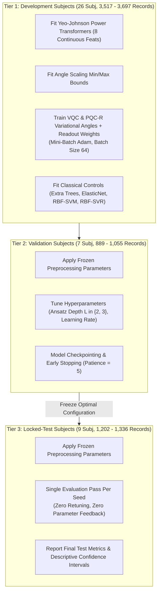
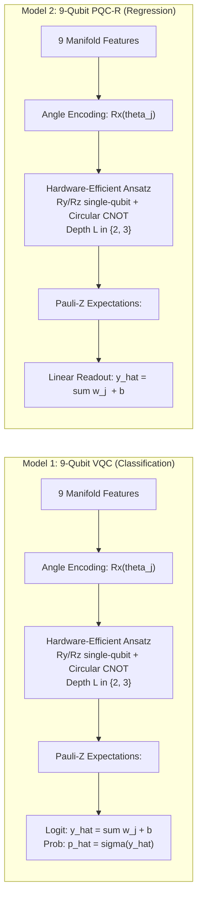

# Phase 5: Quantum Machine Learning (QML) Experimental Plan
## Rigorous Investigation of Exactly Two Quantum Architectures on the Audited 9-Feature Voice Manifold

**Date:** 2026-11-14  
**Author:** Antigravity Research Team  
**Scope:** Streamlined Phase 5 Experimental Protocol Restricted to Exactly Two Quantum Models (VQC & PQC-R)  
**Status:** DRAFT PLAN — AWAITING FORMAL USER APPROVAL (ZERO CODE WRITTEN, ZERO TRAINING EXECUTED)  
**Governing Standard:** Strict Experimental Equality & Zero-Leakage Subject-Wise Partitions  

---

## 1. Executive Summary & Revised Scope

To ensure absolute scientific rigor and avoid dilution across non-essential architectures, Phase 5 evaluates **exactly TWO quantum machine-learning models**:

1. **Model 1: Variational Quantum Classifier (VQC)**
   - **Task:** Binary motor-UPDRS severity classification ($y = \mathbb{I}(\text{motor\_UPDRS} \ge \text{median}_{\text{dev}})$).
   - **Input:** Verified 9-feature acoustic manifold (`['age', 'sex', 'test_time', 'Jitter(%)', 'Shimmer', 'NHR', 'HNR', 'RPDE', 'DFA']`).
   - **Architecture:** 9-qubit VQC with the approved Hardware-Efficient Ansatz (HEA) and circular CNOT entanglement.
   - **Matched Classical Controls:** `ExtraTreesClassifier` (9 features, balanced) and `Classical RBF-SVM` (9 features).
   - **Contextual References (Historical):** Phase 4B Extra Trees 9-feature benchmark (AUC = 0.6618) and Safe Local FedAvg-LR 19-feature benchmark (AUC = 0.6414).

2. **Model 2: Parameterized Quantum Regressor (PQC-R)**
   - **Task:** Continuous motor-UPDRS progression prediction ($y = \text{motor\_UPDRS}$).
   - **Input:** Same verified 9-feature acoustic manifold.
   - **Architecture:** 9-qubit PQC-R with HEA and linear Pauli-Z expectation readout.
   - **Matched Classical Controls:** `ElasticNet(alpha=0.1, l1_ratio=0.5)` (9 features) and `Classical RBF-SVR` (9 features).
   - **Contextual References (Historical):** Phase 4B ElasticNet 9-feature benchmark (MAE = 6.8824) and FedAvg-Ridge 19-feature benchmark (MAE = 6.8993).

### Explicit Exclusions from Phase 5 Implementation:
In strict accordance with the approved mandate, the following architectures and experiments are **permanently removed** from the active Phase 5 scope:
- **QSVC:** Removed (no historical 10-seed benchmark exists; quadratic kernel scaling is non-essential).
- **Four-Qubit Variants:** Removed (lossy PCA compression is excluded; evaluation focuses entirely on the native 9-feature manifold).
- **Personalized PQC-Delta:** Removed (baseline anchoring accounts for 76% of variance; voice biomarker delta prediction is resolved).
- **Separate Quantum Kernel Experiments:** Removed.
- **Any Additional Quantum Architectures:** Strictly prohibited.

---

## 2. Audited Partitions & Exact Sample Counts (Seeds 0–9)

The exact distribution of records across development, validation, and test splits was audited directly from the canonical dataset (`parkinsons_updrs.csv`, 5,875 total records, 42 unique subjects). Because subjects have varying recording densities (ranging from 101 to 168 recordings per subject), the exact record counts vary across the 10 random seeds.

### Audited Partition Record Counts:
| Seed | Dev Subjects | Val Subjects | Test Subjects | Dev Records | Val Records | Locked-Test Records | Total Records |
| :---: | :---: | :---: | :---: | :---: | :---: | :---: | :---: |
| **0** | 26 | 7 | 9 | **3,578** | 991 | 1,306 | 5,875 |
| **1** | 26 | 7 | 9 | **3,565** | 1,055 | 1,255 | 5,875 |
| **2** | 26 | 7 | 9 | **3,652** | 978 | 1,245 | 5,875 |
| **3** | 26 | 7 | 9 | **3,692** | 939 | 1,244 | 5,875 |
| **4** | 26 | 7 | 9 | **3,565** | 1,025 | 1,285 | 5,875 |
| **5** | 26 | 7 | 9 | **3,676** | 934 | 1,265 | 5,875 |
| **6** | 26 | 7 | 9 | **3,697** | 976 | 1,202 | 5,875 |
| **7** | 26 | 7 | 9 | **3,517** | 1,033 | 1,325 | 5,875 |
| **8** | 26 | 7 | 9 | **3,678** | 982 | 1,215 | 5,875 |
| **9** | 26 | 7 | 9 | **3,650** | 889 | 1,336 | 5,875 |
| **Mean $\pm$ SD** | **26.0 $\pm$ 0.0** | **7.0 $\pm$ 0.0** | **9.0 $\pm$ 0.0** | **3,627.0 $\pm$ 61.9** | **980.2 $\pm$ 49.3** | **1,267.8 $\pm$ 44.4** | **5,875** |

*Partition Integrity Rules:*
- Every development record allocated to a seed must be utilized during model fitting.
- No downsampling, no arbitrary record truncation, and no removal of difficult subjects to inflate quantum model scores.
- Zero subject overlap across partitions within any seed:
  $$\mathcal{S}_{\text{dev}}^{(s)} \cap \mathcal{S}_{\text{val}}^{(s)} = \emptyset, \quad \mathcal{S}_{\text{dev}}^{(s)} \cap \mathcal{S}_{\text{test}}^{(s)} = \emptyset, \quad \mathcal{S}_{\text{val}}^{(s)} \cap \mathcal{S}_{\text{test}}^{(s)} = \emptyset$$

---

## 3. Strict Three-Tier Experimental Protocol

To prevent any form of target leakage or implicit tuning on evaluation data, Phase 5 implements an uncompromising three-tier protocol:

1. **Development Subjects (Model Fitting):**
   - Exclusively used to estimate feature transformation parameters (Yeo-Johnson power parameters $\lambda_j$, empirical feature bounds), compute class balance statistics, and optimize quantum variational parameters $\boldsymbol{\theta}$ and readout weights $\mathbf{w}, b$.
2. **Validation Subjects (Model & Hyperparameter Selection):**
   - Transformed strictly using frozen development parameters.
   - Used to select ansatz circuit depth $L \in \{2, 3\}$, learning rate, regularization penalties, and trigger early stopping.
   - Prevents overfitting to the training cohort without accessing locked-test subjects.
3. **Locked-Test Subjects (Final Evaluation Only):**
   - Evaluated strictly **once per seed** after the optimal architecture and hyperparameter set are frozen.
   - Zero feedback from test results is permitted into model architecture or training dynamics.

---

## 4. Input Feature Manifold & Exact Preprocessing Equations

Both quantum models operate exclusively on the verified **9-feature acoustic manifold**:
$$\mathcal{F} = \{ \text{age}, \text{sex}, \text{test\_time}, \text{Jitter(\%)}, \text{Shimmer}, \text{NHR}, \text{HNR}, \text{RPDE}, \text{DFA} \}$$

### 4.1 Treatment of Continuous Acoustic & Clinical Features (8 Features)
1. **Fold-Contained Yeo-Johnson Transformation:**
   For each continuous feature $j \in \mathcal{F}_{\text{cont}}$, parameter $\lambda_j$ is estimated via maximum likelihood strictly on development subjects $X_{\text{dev}}$:
   $$\psi(\lambda_j, x) = \begin{cases} 
   \frac{(x + 1)^{\lambda_j} - 1}{\lambda_j} & \text{if } \lambda_j \ne 0, x \ge 0 \\ 
   \ln(x + 1) & \text{if } \lambda_j = 0, x \ge 0 \\ 
   -\frac{(-x + 1)^{2 - \lambda_j} - 1}{2 - \lambda_j} & \text{if } \lambda_j \ne 2, x < 0 \\ 
   -\ln(-x + 1) & \text{if } \lambda_j = 2, x < 0 
   \end{cases}$$
   Let $z_j = \psi(\lambda_j, x)$ denote the transformed feature.

2. **Angle Normalization to $[-\pi, \pi]$:**
   Quantum rotation gates $R_x(\theta), R_z(\theta)$ have period $2\pi$. Each transformed feature $z_j$ is scaled to $[-\pi, \pi]$ using empirical minimum and maximum bounds computed strictly on $X_{\text{dev}}$:
   $$\theta_j = 2\pi \cdot \left( \frac{z_j - \min_{i \in \text{dev}} z_{i, j}}{\max_{i \in \text{dev}} z_{i, j} - \min_{i \in \text{dev}} z_{i, j} + \epsilon} \right) - \pi, \quad \epsilon = 10^{-8}$$
   For validation and test samples, $\theta_j$ is clipped to $[-\pi, \pi]$ to prevent out-of-bounds extrapolation.

### 4.2 Treatment of Binary Sex (1 Feature)
- **Rationale:** `sex` is an indicator variable ($\text{sex} \in \{0, 1\}$). Applying a Yeo-Johnson power transformation to a binary flag is scientifically invalid.
- **Exact Quantum Mapping:**
  Binary sex is mapped directly to discrete orthogonal quantum rotation angles:
  $$\theta_{\text{sex}} = \begin{cases} 0 & \text{if sex } = 0 \text{ (male)} \\ \pi & \text{if sex } = 1 \text{ (female)} \end{cases}$$
- **Physical Interpretation in State Preparation:**
  $$R_x(0) |0\rangle = |0\rangle, \quad R_x(\pi) |0\rangle = -i |1\rangle$$
  Up to an unobservable global phase factor $-i$, this directly maps binary patient sex to orthogonal computational basis states $|0\rangle$ and $|1\rangle$, providing an exact quantum representation.

---

## 5. Detailed Specifications for the Two Quantum Models

| Architectural Component | Model 1: 9-Qubit VQC (Classification) | Model 2: 9-Qubit PQC-R (Regression) |
| :--- | :--- | :--- |
| **Qubit Register ($N$)** | $N = 9$ qubits | $N = 9$ qubits |
| **Feature Input** | 9 manifold acoustic features | 9 manifold acoustic features |
| **State Preparation** | Angle Encoding: $R_x(\theta_j)$ per qubit | Angle Encoding: $R_x(\theta_j)$ per qubit |
| **Ansatz Topology** | Hardware-Efficient Ansatz (HEA) | Hardware-Efficient Ansatz (HEA) |
| **Single-Qubit Rotations** | $R_y(\theta_{l, j, 1}) R_z(\theta_{l, j, 2})$ | $R_y(\theta_{l, j, 1}) R_z(\theta_{l, j, 2})$ |
| **Entanglement Topology** | Circular CNOT Ladder ($j \to (j+1) \pmod 9$) | Circular CNOT Ladder ($j \to (j+1) \pmod 9$) |
| **Circuit Depth ($L$)** | $L \in \{2, 3\}$ layers | $L \in \{2, 3\}$ layers |
| **Trainable Variational Angles** | $L=2: 36$ angles; $L=3: 54$ angles | $L=2: 36$ angles; $L=3: 54$ angles |
| **Readout Parameters** | Linear: 9 weights + 1 bias = 10 params | Linear: 9 weights + 1 bias = 10 params |
| **Total Trainable Parameters** | **$L=2: 46$ params; $L=3: 64$ params** | **$L=2: 46$ params; $L=3: 64$ params** |
| **Measurement Strategy** | Exact statevector expectation $\langle Z_j \rangle$ | Exact statevector expectation $\langle Z_j \rangle$ |
| **Readout Equation** | $\hat{p} = \sigma\left(\sum_{j=1}^9 w_j \langle Z_j \rangle + b\right)$ | $\hat{y} = \sum_{j=1}^9 w_j \langle Z_j \rangle + b$ |
| **Loss Function** | Binary Cross-Entropy (Class-Weighted) | Mean Squared Error (MSE) + $L_2$ Decay |
| **Simulation Backend** | PennyLane 0.45.0 `default.qubit` (PyTorch) | PennyLane 0.45.0 `default.qubit` (PyTorch) |

### 5.1 Optimization Hyperparameters & Stopping Criteria
- **Optimizer:** Adam with PyTorch automatic differentiation.
- **Initial Learning Rate:** $\eta_0 = 0.01$, with Cosine Annealing decay to $\eta_{\min} = 0.001$.
- **Batch Size:** 64 samples per mini-batch.
- **Regularization Penalty:** $L_2$ weight decay $\lambda = 10^{-4}$ on variational angles and readout weights.
- **Maximum Epochs:** 30 epochs across development records.
- **Early Stopping:** Evaluated every epoch on the **Validation Set** ($X_{\text{val}}$). Training terminates if validation loss does not improve for 5 consecutive epochs (patience = 5). Model weights achieving the lowest validation loss are restored for locked-test evaluation.
- **Random Seeds:** Seeds 0 through 9 matching the 10 audited partition seeds.

### 5.2 Variational Parameter Initialization & Mandatory Gradient Diagnostics
- **Scientific Framing:** Initializing angles uniformly near zero ($\theta \sim \mathcal{U}(-0.05\pi, 0.05\pi)$) is an **initialization heuristic / strategy**, *not* a proven theoretical solution to barren plateaus (McClean et al., 2018; Cerezo et al., 2021).
- **Mandatory Gradient Diagnostics in Logging Plan:**
  The execution framework must log per-epoch gradient metrics:
  1. $L_2$ norm of the parameter gradient vector:
     $$\|\nabla_{\boldsymbol{\theta}} \mathcal{L}\|_2 = \sqrt{\sum_{k} \left(\frac{\partial \mathcal{L}}{\partial \theta_k}\right)^2}$$
  2. Variance of gradient components across mini-batches: $\text{Var}\left(\frac{\partial \mathcal{L}}{\partial \theta_k}\right)$.
  3. Minimum and maximum layer-wise gradient magnitudes.
  4. An automatic diagnostic flag will warn if gradient variance falls below $10^{-6}$, indicating vanishing gradient pathology.

### 5.3 Computational Overhead & Mandatory Profiling
- All wall-clock runtime figures are designated as **preliminary theoretical estimates**.
- **Mandatory Empirical Profiling:** During execution, the logging script must capture:
  1. Actual wall-clock training time per epoch and total runtime per seed (`time.perf_counter()`).
  2. Peak host process memory consumption (`psutil.Process().memory_info().rss`).
  3. Exact epoch of convergence based on validation loss early stopping.
  4. Numerical stability (loss NaN/Inf checks at every batch).

---

## 6. Model Parity Matrix & Matched Classical Controls

Both quantum models have rigorously matched classical controls sharing identical feature sets, subject partitions, targets, and evaluation metrics:

| Task | Target Definition | Quantum Model | Matched Classical Control Model | Exact Input Feature Space | Preprocessing / Fitting Source | Benchmark Status | Benchmark Score |
| :--- | :--- | :--- | :--- | :--- | :--- | :--- | :---: |
| **Classification** | $y = \mathbb{I}(\text{motor} \ge \text{med}_{\text{dev}})$ | **9-Qubit VQC (HEA)** | `ExtraTreesClassifier` | 9-Feat Pruned Manifold | Fitted Exclusively on $X_{\text{dev}}$ | Historical Frozen Benchmark | **ROC-AUC: 0.6618 $\pm$ 0.1077** |
| **Classification** | $y = \mathbb{I}(\text{motor} \ge \text{med}_{\text{dev}})$ | **9-Qubit VQC (HEA)** | `Classical RBF-SVM` | 9-Feat Pruned Manifold | Fitted Exclusively on $X_{\text{dev}}$ | New Matched Control for Phase 5 | *To be fitted in Phase 5 on 9 feats* |
| **Classification** | $y = \mathbb{I}(\text{motor} \ge \text{med}_{\text{dev}})$ | Contextual Reference | `Safe Local FedAvg-LR` | 19 Original Features | Edge-26 Decentralized Standardized | Historical Frozen Benchmark | **ROC-AUC: 0.6414 $\pm$ 0.1118** |
| **Classification** | $y = \mathbb{I}(\text{motor} \ge \text{med}_{\text{dev}})$ | Contextual Reference | `Centralized Logistic Reg` | 19 Original Features | Fitted Exclusively on $X_{\text{dev}}$ | Historical Frozen Benchmark | **ROC-AUC: 0.5775 $\pm$ 0.0811** |
| **Regression** | $y = \text{motor\_UPDRS}$ | **9-Qubit PQC-R** | `ElasticNet(alpha=0.1, l1=0.5)` | 9-Feat Pruned Manifold | Fitted Exclusively on $X_{\text{dev}}$ | Historical Frozen Benchmark | **MAE: 6.8824 $\pm$ 0.9988** |
| **Regression** | $y = \text{motor\_UPDRS}$ | **9-Qubit PQC-R** | `Classical RBF-SVR` | 9-Feat Pruned Manifold | Fitted Exclusively on $X_{\text{dev}}$ | New Matched Control for Phase 5 | *To be fitted in Phase 5 on 9 feats* |
| **Regression** | $y = \text{motor\_UPDRS}$ | Contextual Reference | `FedAvg-Ridge Regressor` | 19 Original Features | Edge-26 Decentralized Standardized | Historical Frozen Benchmark | **MAE: 6.8993 $\pm$ 0.8879** |
| **Regression** | $y = \text{motor\_UPDRS}$ | Contextual Reference | `Centralized Ridge` | 19 Original Features | Fitted Exclusively on $X_{\text{dev}}$ | Historical Frozen Benchmark | **MAE: 7.0653 $\pm$ 0.9419** |

---

## 7. Simulated Quantum Noise Resilience Evaluation

The two selected quantum models (VQC and PQC-R) will be evaluated across four distinct noise and measurement configurations. **These are evaluation configurations of the two models, not additional model architectures:**

### 7.1 Distinction Between Classical Simulation and Physical QPUs
- **Statevector Simulation:** Exact matrix-vector multiplication in $\mathbb{C}^{512}$ with infinite shot precision. Zero physical decoherence, zero thermal relaxation, zero physical gate crosstalk.
- **Physical NISQ Hardware:** Physical transmon/ion qubits subject to $T_1$ relaxation, $T_2$ dephasing, control electronics drift, readout assignment fidelity errors ($1-3\%$), and sparse physical coupling graphs.
- **Scientific Boundary:** Phase 5 simulates noise mathematically via density matrices and Kraus operators. **We make zero claims of real hardware validation or physical deployment.**

### 7.2 Simulated Noise Channels (via PennyLane `default.mixed`)
1. **Ideal Statevector Reference:** Baseline evaluation with zero simulated noise.
2. **Single- and Two-Qubit Depolarizing Channel:**
   $$\mathcal{E}_{\text{depol}}(\rho) = (1 - p) \rho + \frac{p}{4^n - 1} \sum_{k=1}^{4^n - 1} P_k \rho P_k$$
   Evaluated at error rates $p \in \{10^{-4}, 10^{-3}, 5 \times 10^{-3}, 10^{-2}\}$.
3. **Phase Damping (Dephasing) Channel:**
   $$\mathcal{E}_{\text{phase}}(\rho) = (1 - \gamma) \rho + \gamma Z \rho Z$$
   Evaluated at damping probabilities $\gamma \in \{10^{-3}, 10^{-2}, 5 \times 10^{-2}\}$.
4. **Finite Measurement Shot Noise:**
   Assessing performance degradation when expectation values are estimated with finite shots $S \in \{1000, 4000, 10000\}$ versus exact analytic statevector simulation.

---

## 8. Summary of Preservation & Execution Rules

1. **Preservation:** All Phase 3, Phase 3B, Phase 4, and Phase 4B directories, results, figures, and CSV files remain strictly immutable.
2. **Directory Isolation:** Phase 5 artifacts, code, checkpoints, and reports reside exclusively in `experiments/phase5/`.
3. **Execution Rule:** **No experimental code shall be written, no models shall be trained, and no execution scripts shall be launched until this revised plan and pre-execution checklist are formally approved.**
