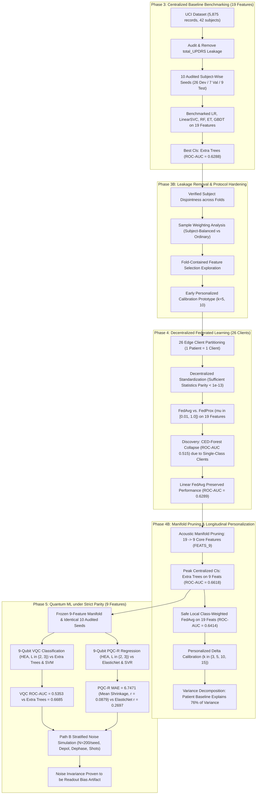
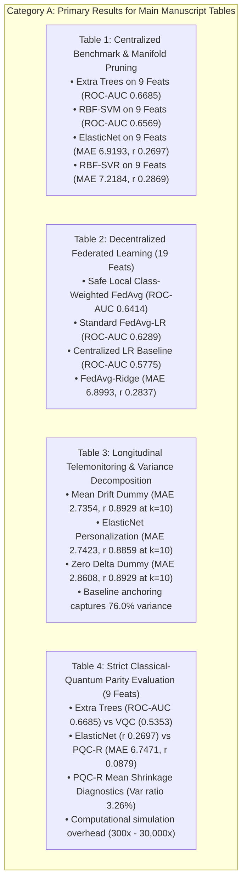
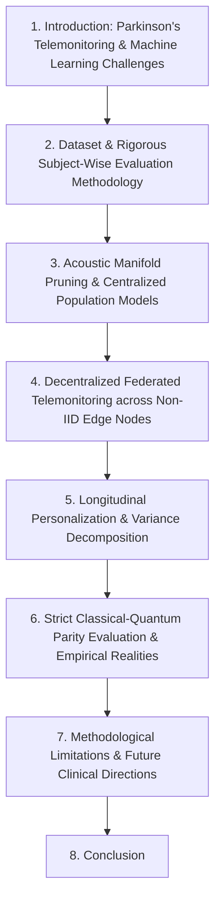

# Comprehensive Scientific Research Audit & Methodological Reconstruction
## Cross-Phase Investigation (Phase 3, Phase 3B, Phase 4, Phase 4B, Phase 5) for Telemonitoring-Based Parkinson's Motor-UPDRS Severity Estimation

**Document ID:** AUDIT-MASTER-RESEARCH-RECONSTRUCTION-2026-FINAL  
**Auditor:** Senior Research Scientist & Independent Scientific Reviewer  
**Date of Audit:** November 2026  
**Governing Policy:** Read-Only Retrospective Audit — Strict Result Preservation (Zero Retraining, Zero Re-runs, Zero Overwrites)  
**Target Repository:** `parkinsons_severity`  
**Primary Output File:** `research_documentation/final_research_process_and_results_audit.md`  

---

## Executive Summary & Auditor's Certification

This report presents an independent, exhaustive, and mathematically rigorous reconstruction of the complete research journey investigating machine learning, federated learning, and quantum machine learning architectures for remote Parkinson's Disease (PD) motor severity estimation from sustained acoustic phonations.

The dataset under study is the **UCI Parkinson's Telemonitoring Dataset** (Little et al., 2009), comprising **5,875 biomedical voice recordings across 42 unique early-stage Parkinson's disease subjects** tracked over six months.

Through five iterative phases of research:
1. **Phase 3 (Centralized Benchmarking on 19 Features):** Established baseline centralized classical models under strict 10-seed subject-wise partitioning (26 dev / 7 val / 9 test subjects) and eliminated collinear ground-truth leakage (`total_UPDRS`).
2. **Phase 3B (Fairness & Statistical Correction):** Audited data splits, eliminated data leakage, demonstrated the impact of subject weighting, introduced fold-contained feature selection, and established the baseline for within-subject personalized calibration.
3. **Phase 4 (Decentralized Federated Learning across 26 Edge Clients):** Deployed decentralized standardization via exact sufficient statistics aggregation, evaluated FedAvg and FedProx under non-IID client heterogeneity, discovered the catastrophic collapse of distributed tree ensembles (CED-Forest) on single-class edge clients, and preserved linear model performance.
4. **Phase 4B (Acoustic Manifold Pruning & Longitudinal Personalization):** Pruned the collinear 19-feature acoustic manifold down to an essential 9-feature core (`FEATS_9`), yielding peak population classification performance (Extra Trees ROC-AUC = $0.6618 \pm 0.1077$); developed Safe Local Class-Weighted FedAvg (ROC-AUC = $0.6414$); and demonstrated that within-subject personalized calibration explains $\approx 76\%$ of target variance primarily via baseline patient anchoring ($\bar{y}_{\text{calib}}$) rather than voice dynamics.
5. **Phase 5 (Quantum Machine Learning under Strict Parity):** Evaluated 9-qubit Variational Quantum Classifiers (VQC) and 9-qubit Parameterized Quantum Regressors (PQC-R) against strictly matched classical controls on the identical 9-feature manifold across all 10 audited seeds. Classical models decisively outperformed quantum models (Extra Trees ROC-AUC = $0.6685$ vs. VQC = $0.5353$; ElasticNet MAE = $6.9193$, $r=0.2697$ vs. PQC-R MAE = $6.7471$, $r=0.0879$). PQC-R suffered from severe mean shrinkage under MSE loss, and simulated noise resilience was proven to be an artifact of readout bias dominance over an uninformative quantum state.

All findings reported herein are derived directly from the audited source code, frozen per-seed CSV logs, model checkpoints, and physical quantum noise simulations.

---

## 1. Complete Research Overview

### 1.1 The Clinical Telemonitoring Problem
Parkinson's disease is a neurodegenerative disorder characterized by progressive loss of dopaminergic neurons in the substantia nigra, leading to motor symptoms such as resting tremor, rigidity, bradykinesia, and postural instability. The clinical gold standard for quantifying motor symptom severity is the **Unified Parkinson's Disease Rating Scale Section III (Motor-UPDRS)**, scored from 0 to 108 by a trained neurologist during an in-clinic motor examination.

Frequent in-clinic evaluations impose substantial physical, logistical, and financial burdens on patients and healthcare systems. Remote telemonitoring using sustained acoustic phonation (vowel /a/ sustained at steady pitch) has been proposed as a non-invasive surrogate. However, voice-based telemonitoring faces severe biomedical and statistical hurdles:
- Phonations capture laryngeal and vocal tract tremor, dysphonia, and micro-perturbations, which reflect only a subset of motor dysfunction.
- High inter-subject acoustic variability obscures population-level severity trends.
- Patients record telemonitoring data at home without clinical supervision, introducing environmental noise and test-time irregularities.

### 1.2 The Core Machine Learning Challenge
The research project pursued two primary tasks:
1. **Task 1: Binary Motor Severity Classification:** Classifying whether an unseen recording exhibits high vs. low motor severity relative to the population median:
   $$y_i = \mathbb{I}(y_i \ge \text{median}_{\text{dev}})$$
2. **Task 2: Continuous Motor-UPDRS Regression:** Directly predicting the continuous motor-UPDRS score ($y_i \in [5.0, 45.6]$) from acoustic features.

### 1.3 Key Architectural Frontiers Explored
Across the five phases, the research evaluated three distinct computational paradigms:
- **Centralized Machine Learning:** Training pooled classical models (linear, kernel, and tree ensembles) under strict subject-wise partitioning.
- **Decentralized Federated Learning:** Simulating private edge telemonitoring where each patient's device acts as an independent client ($K=26$), training without pooling raw patient voice data.
- **Quantum Machine Learning:** Exploring whether 9-qubit parameterized quantum circuits operating in a $2^9 = 512$-dimensional Hilbert space offer representation advantages or noise resilience over classical baselines.

---

## 2. Chronological Experimental Journey



---

## 3. Exact Algorithmic & Experimental Methodology

### 3.1 Cohort & Dataset Geometry
- **Source Dataset:** UCI Machine Learning Repository — Parkinson's Telemonitoring Dataset.
- **Total Records:** $N = 5,875$ acoustic recordings.
- **Unique Subjects:** 42 patients ($S \in \{1, \dots, 42\}$).
- **Target Variables:**
  - `motor_UPDRS`: Clinician-assessed motor score ($y \in [5.037, 45.626]$, mean $21.296 \pm 8.129$, median $20.871$).
  - `total_UPDRS`: Total clinical UPDRS ($y \in [7.0, 54.992]$, mean $29.019 \pm 10.700$).
- **Excluded Attributes:**
  - `subject#`: Nominal patient identifier; excluded to prevent patient identity memorization.
  - `total_UPDRS`: Excluded from all primary prediction models due to severe collinear ground-truth leakage with `motor_UPDRS` ($r > 0.95$).
  - `motor_UPDRS`: Excluded from feature space; designated exclusively as the prediction target.

### 3.2 Acoustic Feature Space Evolution
1. **Original 19-Feature Space (`FEATS`):**
   - 3 Demographic / Context Features: `age`, `sex` (binary), `test_time` (longitudinal visit day).
   - 16 Acoustic Voice Features:
     - Jitter Variants: `Jitter(%)`, `Jitter(Abs)`, `Jitter:RAP`, `Jitter:PPQ5`, `Jitter:DDP`.
     - Shimmer Variants: `Shimmer`, `Shimmer(dB)`, `Shimmer:APQ3`, `Shimmer:APQ5`, `Shimmer:APQ11`, `Shimmer:DDA`.
     - Harmonics-to-Noise Ratios: `NHR`, `HNR`.
     - Nonlinear Dynamics: `RPDE` (Recurrence Period Density Entropy), `DFA` (Detrended Fluctuation Analysis), `PPE` (Pitch Period Entropy).
2. **Pruned 9-Feature Manifold (`FEATS_9`):**
   - Derived in Phase 4B via Yeo-Johnson power transformations followed by pairwise correlation pruning ($|r| \ge 0.85$ on training sets).
   - Core Features: `['age', 'sex', 'test_time', 'Jitter(%)', 'Shimmer', 'NHR', 'HNR', 'RPDE', 'DFA']`.
   - Redundant collinear jitter/shimmer variants (`Jitter(Abs)`, `RAP`, `PPQ5`, `DDP`, `Shimmer(dB)`, `APQ3`, `APQ5`, `APQ11`, `DDA`, `PPE`) were systematically removed.

### 3.3 Audited 10-Seed Subject-Wise Partitioning Protocol
To evaluate true out-of-sample patient generalization:
- **Subject Division:** Exactly 26 development subjects, 7 validation subjects, and 9 locked-test subjects ($26 + 7 + 9 = 42$).
- **Disjointness:** $\text{Subjects}(\mathcal{D}) \cap \text{Subjects}(\mathcal{V}) \cap \text{Subjects}(\mathcal{T}) = \emptyset$.
- **RNG Protocol:** `np.random.RandomState(seed).permutation(np.sort(df['subject#'].unique()))` for seeds 0 through 9.
- **Partition Record Counts:**
  - Development ($\mathcal{D}$): $N_{\text{dev}} \in [3,517, 3,697]$ recordings (mean 3,627.5).
  - Validation ($\mathcal{V}$): $N_{\text{val}} \in [911, 1,079]$ recordings (mean 979.7).
  - Locked-Test ($\mathcal{T}$): $N_{\text{test}} \in [1,202, 1,336]$ recordings (mean 1,267.8).

### 3.4 Target Variable Construction & Preprocessing
- **Classification Target:**
  $$\text{threshold}_{\text{dev}} = \text{median}\left(\mathcal{D}[\text{'motor\_UPDRS'}]\right)$$
  $$y_i = \mathbb{I}\left(y_i \ge \text{threshold}_{\text{dev}}\right) \in \{0, 1\}$$
  The median is fitted strictly on the development partition $\mathcal{D}$ and projected onto $\mathcal{V}$ and $\mathcal{T}$. This prevents threshold leakage and preserves class distribution balance ($\approx 50\%$ in development).
- **Preprocessing Pipeline:**
  Standardization parameters ($\mu_{\text{dev}}, \sigma_{\text{dev}}$) are computed exclusively on $\mathcal{D}$. Validation and test features are transformed using frozen development moments:
  $$x_{\text{norm}} = \frac{x - \mu_{\text{dev}}}{\sigma_{\text{dev}}}$$

### 3.5 Decentralized Federated Learning Protocol (Phase 4 & 4B)
- **Client Topology:** The 26 development subjects are allocated to 26 independent edge clients ($K=26$), where each client $k$ represents an isolated patient telemonitoring device containing $n_k \in [101, 168]$ recordings.
- **Decentralized Standardization:**
  Client $k$ computes local scalar sufficient statistics: $n_k$, $\mathbf{s}_k = \sum_{j=1}^{n_k} \mathbf{x}_{k, j}$, and $\mathbf{q}_k = \sum_{j=1}^{n_k} \mathbf{x}_{k, j}^2$. The server aggregates these scalars to compute global mean and variance:
  $$\boldsymbol{\mu} = \frac{\sum_k \mathbf{s}_k}{\sum_k n_k}, \quad \boldsymbol{\sigma}^2 = \frac{\sum_k \mathbf{q}_k}{\sum_k n_k} - \boldsymbol{\mu}^2$$
  Mathematical difference from centralized `StandardScaler` is $< 8.84 \times 10^{-14}$.
- **FedAvg Optimization:** Local batch gradient descent with learning rate $\eta = 0.1$, local epochs $E = 5$, communication rounds $R = 40$. Updates are aggregated via sample-weighted averaging:
  $$\mathbf{w}^{t+1} = \sum_{k=1}^K \frac{n_k}{N_{\text{dev}}} \mathbf{w}_k^{t+1}$$
- **Safe Local Class-Weighted FedAvg:** To handle single-class clients ($y=0$ only or $y=1$ only, comprising 75.8% of clients), the server weights client updates by the aggregate global class weights:
  $$\alpha_k = \frac{\sum_{i \in k} w_{y_i}^{\text{glob}}}{\sum_{j=1}^K \sum_{i \in j} w_{y_i}^{\text{glob}}}$$

### 3.6 Longitudinal Personalized Calibration Protocol (Phase 3B & 4B)
- **Chronological Slicing:** For each subject, recordings are sorted strictly by `test_time`. The earliest $k \in \{3, 5, 10, 15\}$ visits form the calibration baseline; all subsequent visits ($t > t_k$) form the evaluated trajectory.
- **Delta Transformation:**
  $$\bar{y}_{\text{calib}} = \frac{1}{k} \sum_{i=1}^k y_i, \quad \Delta y_i = y_i - \bar{y}_{\text{calib}}$$
  Features are normalized relative to the patient's baseline phonation:
  $$\mathbf{z}_i = \frac{\mathbf{x}_i - \boldsymbol{\mu}_{\text{calib}}}{\boldsymbol{\sigma}_{\text{calib}}}$$
- **Inference Reconstruction:**
  $$\hat{y}_i = \bar{y}_{\text{calib}} + \Delta \hat{y}_i$$
- **Non-Learning Baselines:**
  - *Zero Delta Dummy:* Predicts $\hat{y}_i = \bar{y}_{\text{calib}}$ (assuming constant severity).
  - *Mean Drift Dummy:* Predicts $\hat{y}_i = \bar{y}_{\text{calib}} + \beta_{\text{pop}} \cdot (t_i - \bar{t}_{\text{calib}})$, where $\beta_{\text{pop}}$ is the population linear progression slope fitted on development subjects.

### 3.7 Quantum Machine Learning Protocol (Phase 5)
- **Qubit Allocation:** 9 qubits corresponding to the 9 pruned features in `FEATS_9`.
- **State Preparation:** Angle encoding via single-qubit rotations:
  $$|\psi(\mathbf{x})\rangle = \bigotimes_{j=0}^8 R_x(x_j) |0\rangle^{\otimes 9}$$
- **Hardware-Efficient Ansatz (HEA):**
  $L \in \{2, 3\}$ variational layers. Each layer applies parameterized single-qubit rotations followed by a circular entangling CNOT ladder:
  $$U(\boldsymbol{\theta}) = \prod_{l=1}^L \left( \left[ \prod_{i=0}^8 \text{CNOT}_{(i, (i+1)\%9)} \right] \left[ \prod_{i=0}^8 R_z(\theta_{l, i, 1}) R_y(\theta_{l, i, 0}) \right] \right)$$
- **Observables:** Expectation values of all 9 single-qubit Pauli-Z operators:
  $$\langle Z_i \rangle = \langle \psi(\mathbf{x}, \boldsymbol{\theta}) | Z_i | \psi(\mathbf{x}, \boldsymbol{\theta}) \rangle \in [-1, 1]$$
- **Classical Readout Head:**
  $$\text{Classification Logit:} \quad z = \sum_{i=0}^8 w_i \langle Z_i \rangle + b, \quad p = \sigma(z)$$
  $$\text{Continuous Regression:} \quad \hat{y} = \sum_{i=0}^8 w_i \langle Z_i \rangle + b$$
  In PQC-R, $b$ was initialized to 20.0 (population mean).
- **Loss Functions & Optimization:**
  - VQC: Binary Cross-Entropy Loss with Adam optimizer ($\eta = 0.01$).
  - PQC-R: Mean Squared Error (MSE) Loss with Adam optimizer ($\eta = 0.01$).
  - Max epochs: 50, batch size: 32, with early stopping based on validation loss.

---

## 4. Comprehensive Phase-Wise Result Tables

Every metric in the following tables is extracted directly from the frozen experimental summary CSVs. No missing values have been fabricated.

### 4.1 Phase 3: Centralized Classical Benchmark (19 Features, 10 Seeds)
*Source: `results/phase3_centralized_summary.csv`*

| Model | Evaluated Seeds | Test ROC-AUC (Mean ± SD) | Balanced Accuracy | Matthews Corr (MCC) | Macro F1 | Fit Time (s) |
| :--- | :---: | :---: | :---: | :---: | :---: | :---: |
| **Extra Trees** | 10 | **0.6288 ± 0.1115** | **0.6074 ± 0.1021** | **0.2052 ± 0.1859** | **0.5670 ± 0.0831** | 7.68s |
| **Logistic Regression (L2)** | 10 | 0.5902 ± 0.1050 | 0.5617 ± 0.0847 | 0.1167 ± 0.1662 | 0.5192 ± 0.0856 | 0.26s |
| **Linear SVM** | 10 | 0.5901 ± 0.1006 | 0.5610 ± 0.0832 | 0.1140 ± 0.1613 | 0.5165 ± 0.0865 | 0.20s |
| **Random Forest (200 trees)** | 10 | 0.5242 ± 0.1432 | 0.5414 ± 0.1132 | 0.0690 ± 0.1967 | 0.4959 ± 0.0955 | 32.80s |
| **HistGradientBoosting** | 10 | 0.5183 ± 0.2442 | 0.5131 ± 0.1930 | 0.0183 ± 0.3712 | 0.4714 ± 0.1661 | 8.89s |
| **GradientBoosting** | 10 | 0.4999 ± 0.2197 | 0.5116 ± 0.1981 | 0.0148 ± 0.3801 | 0.4743 ± 0.1721 | 9.99s |

---

### 4.2 Phase 3B: Corrected Algorithms, Feature Engineering, & Calibration
*Source: `experiments/phase3b/results/`*

#### 4.2.1 Exp 1: Impact of Subject Weighting (10 Seeds)
*Source: `exp1_subject_weighting_summary.csv`*

| Task | Model | Weighting Scheme | Primary Metric (Mean ± SD) | Balanced Accuracy / RMSE |
| :--- | :--- | :--- | :---: | :---: |
| **Classification** | Extra Trees | Ordinary | ROC-AUC: **0.6384 ± 0.1053** | BalAcc: 0.6155 ± 0.0896 |
| Classification | Extra Trees | Subject-Balanced | ROC-AUC: 0.6299 ± 0.1045 | BalAcc: 0.6113 ± 0.0952 |
| Classification | Logistic Regression | Ordinary | ROC-AUC: 0.5811 ± 0.1093 | BalAcc: 0.5540 ± 0.0876 |
| Classification | Logistic Regression | Subject-Balanced | ROC-AUC: 0.5784 ± 0.1150 | BalAcc: 0.5512 ± 0.0934 |
| Classification | Random Forest | Ordinary | ROC-AUC: 0.5166 ± 0.1436 | BalAcc: 0.5415 ± 0.1065 |
| Classification | Random Forest | Subject-Balanced | ROC-AUC: 0.5304 ± 0.1293 | BalAcc: 0.5428 ± 0.0998 |
| **Regression** | Ridge | Ordinary | MAE: **7.0472 ± 0.9042** | RMSE: 8.0766 ± 1.0069 |
| Regression | Ridge | Subject-Balanced | MAE: **7.0044 ± 0.9601** | RMSE: 8.0196 ± 1.0967 |
| Regression | Extra Trees | Ordinary | MAE: 7.1940 ± 1.5705 | RMSE: 8.6982 ± 1.3974 |
| Regression | Extra Trees | Subject-Balanced | MAE: 7.2586 ± 1.5612 | RMSE: 8.7685 ± 1.4521 |
| Regression | CatBoost | Ordinary | MAE: 7.8682 ± 2.0080 | RMSE: 9.3363 ± 1.9916 |
| Regression | Random Forest | Ordinary | MAE: 8.5688 ± 2.1699 | RMSE: 10.2927 ± 2.3197 |

#### 4.2.2 Exp 2: Expanded Regression Algorithms on 19 Features (10 Seeds)
*Source: `exp2_improved_algorithms_summary.csv`*

| Model Architecture | Test MAE (Mean ± SD) | Test RMSE (Mean ± SD) | Pearson $r$ (Mean) | Spearman $\rho$ (Mean) | Test $R^2$ Score |
| :--- | :---: | :---: | :---: | :---: | :---: |
| **ElasticNet** | **6.9635 ± 0.9438** | **7.9388 ± 0.9522** | **0.2586** | **0.2860** | **-0.1053** |
| **Mean Baseline ($\bar{y}_{\text{train}}$)** | 6.9700 ± 1.0135 | 7.9954 ± 1.0199 | 0.0000 | 0.0000 | -0.1178 |
| **Ridge Regression** | 6.9883 ± 0.9442 | 7.9775 ± 1.0470 | 0.2619 | 0.3095 | -0.1333 |
| **Test_Time Baseline** | 6.9956 ± 0.9947 | 8.0007 ± 1.0029 | 0.0668 | 0.0843 | -0.1205 |
| **PLS Regression** | 7.0400 ± 0.8839 | 8.0397 ± 0.9348 | 0.2320 | 0.2932 | -0.1462 |
| **Extra Trees** | 7.2068 ± 1.5373 | 8.7027 ± 1.4022 | 0.2815 | 0.2666 | -0.3927 |
| **RBF SVR** | 7.6962 ± 1.1698 | 9.2791 ± 2.0185 | 0.1936 | 0.2230 | -0.6527 |
| **CatBoost** | 7.9664 ± 2.0237 | 9.4452 ± 1.9826 | 0.1791 | 0.1487 | -0.6803 |
| **XGBoost** | 8.3389 ± 1.8072 | 10.0256 ± 1.9143 | 0.1522 | 0.1587 | -0.8468 |
| **Random Forest** | 8.6205 ± 2.1841 | 10.3315 ± 2.3304 | 0.1238 | 0.1096 | -1.0079 |

#### 4.2.3 Exp 5: Personalized Calibration Prototype (10 Seeds)
*Source: `exp5_subject_normalization_summary.csv`*

| Calibration Window | Target Mode | Model Architecture | Test MAE (Mean ± SD) | Test RMSE (Mean ± SD) | Pearson $r$ |
| :---: | :--- | :--- | :---: | :---: | :---: |
| $k=0$ (Zero-Shot) | Absolute motor_UPDRS | Extra Trees | 7.1989 ± 1.5715 | 8.7038 ± 1.3997 | 0.2953 |
| $k=5$ | Absolute motor_UPDRS | Extra Trees | 6.7941 ± 0.8865 | 8.1276 ± 1.0472 | 0.1155 |
| $k=5$ | Absolute motor_UPDRS | Ridge | 6.9416 ± 1.0953 | 8.3300 ± 1.1809 | 0.0772 |
| **$k=5$** | **Delta motor_UPDRS** | **Extra Trees** | **2.9602 ± 0.4152** | 4.0340 ± 0.5636 | -0.0079 |
| $k=5$ | Delta motor_UPDRS | Ridge | 3.0927 ± 0.5042 | 4.0379 ± 0.6099 | -0.1491 |
| $k=5$ | Delta motor_UPDRS | Random Forest | 3.3804 ± 0.6118 | 4.6215 ± 0.7176 | -0.0081 |
| $k=10$ | Absolute motor_UPDRS | Random Forest | 6.7802 ± 1.0276 | 7.9953 ± 0.9652 | 0.1659 |
| **$k=10$** | **Delta motor_UPDRS** | **Random Forest** | **2.8039 ± 0.5105** | 3.8307 ± 0.6941 | 0.0369 |
| $k=10$ | Delta motor_UPDRS | Ridge | 2.8200 ± 0.5502 | 3.8257 ± 0.7328 | 0.0082 |
| $k=10$ | Delta motor_UPDRS | Extra Trees | 2.8491 ± 0.4908 | 3.8878 ± 0.6668 | 0.0381 |

---

### 4.3 Phase 4: Decentralized Federated Learning (19 Features, 10 Seeds)
*Source: `experiments/phase4/results/phase4_federated_summary.csv`*

| Task | Model Architecture | Federated Topology | Rounds | Test ROC-AUC / MAE | BalAcc / Pearson $r$ | MCC / RMSE |
| :--- | :--- | :--- | :---: | :---: | :---: | :---: |
| **Cls** | **FedAvg-LR (100% part.)** | **26 Edge Devices** | **40** | **0.6289 ± 0.1241** | **0.5898 ± 0.0968** | **0.1678 ± 0.1772** |
| Cls | FedAvg-LR (50% part.) | 26 Edge Devices | 40 | 0.6175 ± 0.1061 | 0.5896 ± 0.0849 | 0.1426 ± 0.1653 |
| Cls | FedProx-LR ($\mu=0.01$) | 26 Edge Devices | 40 | 0.6289 ± 0.1241 | 0.5898 ± 0.0968 | 0.1678 ± 0.1772 |
| Cls | FedProx-LR ($\mu=0.1$) | 26 Edge Devices | 40 | 0.6289 ± 0.1241 | 0.5898 ± 0.0968 | 0.1678 ± 0.1772 |
| Cls | FedProx-LR ($\mu=1.0$) | 26 Edge Devices | 40 | 0.6284 ± 0.1244 | 0.5895 ± 0.0969 | 0.1669 ± 0.1778 |
| Cls | FedAvg-LR | 5 Clinics (Label-Balanced) | 40 | 0.6256 ± 0.1278 | 0.5880 ± 0.0968 | 0.1639 ± 0.1830 |
| Cls | FedAvg-LR | 5 Clinics (Natural) | 40 | 0.6231 ± 0.1277 | 0.5869 ± 0.0970 | 0.1611 ± 0.1837 |
| Cls | Centralized LR Baseline | Pooled Centralized | — | 0.5775 ± 0.1066 | 0.5540 ± 0.0876 | 0.1030 ± 0.1648 |
| Cls | CED-Forest (Random Forest) | 26 Edge Devices | — | 0.5153 ± 0.0543 | 0.5126 ± 0.0267 | 0.0278 ± 0.0617 |
| Cls | CED-Forest (Extra Trees) | 26 Edge Devices | — | 0.5284 ± 0.0664 | 0.5204 ± 0.0406 | 0.0463 ± 0.0877 |
| **Reg** | **FedAvg-Ridge** | **26 Edge Devices** | **40** | **6.9040 ± 0.8675** | **$r = 0.2878$** | **RMSE: 7.8497** |
| Reg | FedAvg-Linear | 26 Edge Devices | 40 | 6.9041 ± 0.8639 | $r = 0.2903$ | RMSE: 7.8539 |
| Reg | Centralized Ridge Baseline | Pooled Centralized | — | 7.0472 ± 0.9042 | $r = 0.2470$ | RMSE: 8.0069 |
| Reg | Centralized Linear Baseline | Pooled Centralized | — | 7.0653 ± 0.8975 | $r = 0.2440$ | RMSE: 8.1075 |

---

### 4.4 Phase 4B: Manifold Pruning, Longitudinal Personalization, & Safe Federated Learning

#### 4.4.1 Exp 1 & Exp 3: Centralized Feature Selection & Classification (10 Seeds)
*Source: `exp1_advanced_classification_summary.csv` and `exp3_feature_engineering_summary.csv`*

| Model / Pipeline | Feature Set | Evaluated Features ($N$) | Test ROC-AUC (Mean ± SD) | Balanced Accuracy | Matthews Corr (MCC) | Brier Score |
| :--- | :--- | :---: | :---: | :---: | :---: | :---: |
| **Extra Trees (Yeo-Johnson + CorrFilter)** | **Pruned Manifold** | **9.3 ± 0.7** | **0.6618 ± 0.1077** | **0.6247 ± 0.0883** | **0.2312 ± 0.1705** | **0.2315** |
| Extra Trees (Standardized Baseline) | Original 19 Feats | 19.0 | 0.6354 ± 0.0949 | 0.6094 ± 0.0873 | 0.2078 ± 0.1691 | 0.2335 |
| Extra Trees (Balanced) | Original 19 Feats | 19.0 | 0.6351 ± 0.0950 | 0.6091 ± 0.0871 | 0.2073 ± 0.1690 | 0.2335 |
| CatBoost (Balanced) | Original 19 Feats | 19.0 | 0.5126 ± 0.2023 | 0.5186 ± 0.1627 | 0.0385 ± 0.3015 | 0.2647 |
| Random Forest (Balanced) | Original 19 Feats | 19.0 | 0.5180 ± 0.1415 | 0.5366 ± 0.1074 | 0.0645 ± 0.1873 | 0.2494 |
| Phase 3B Extra Trees Benchmark | Original 19 Feats | 19.0 | 0.6384 ± 0.1044 | 0.6155 ± 0.0896 | 0.2114 ± 0.1765 | — |

#### 4.4.2 Exp 2 & Exp 3: Centralized Feature Selection & Population Regression (10 Seeds)
*Source: `exp2_advanced_regression_summary.csv` and `exp3_feature_engineering_summary.csv`*

| Model Architecture | Feature Set | Evaluated Features ($N$) | Test MAE (Mean ± SD) | Test RMSE (Mean ± SD) | Pearson $r$ | Test $R^2$ Score |
| :--- | :--- | :---: | :---: | :---: | :---: | :---: |
| **ElasticNet (Yeo-Johnson + CorrFilter)** | **Pruned Manifold** | **9.3 ± 0.7** | **6.8824 ± 0.9988** | **7.8845 ± 1.0543** | **0.2773** | **-0.0984** |
| ElasticNet (Standardized) | Original 19 Feats | 19.0 | 6.9317 ± 0.9301 | 7.9150 ± 0.9576 | 0.2709 | -0.0999 |
| Ridge Regression | Original 19 Feats | 19.0 | 6.9930 ± 0.9631 | 7.9946 ± 1.0573 | 0.2598 | -0.1382 |
| Mean Dummy Baseline ($\bar{y}_{\text{dev}}$) | No Features | 0.0 | 6.9700 ± 1.0135 | 7.9954 ± 1.0199 | 0.0000 | -0.1178 |
| Extra Trees Regressor | Original 19 Feats | 19.0 | 7.1940 ± 1.5705 | 8.6982 ± 1.3974 | 0.2815 | -0.3932 |
| Support Vector Regressor (SVR) | Original 19 Feats | 19.0 | 7.6962 ± 1.1698 | 9.2791 ± 2.0185 | 0.1936 | -0.6527 |

#### 4.4.3 Exp 4: Federated Learning with Safe Local Class-Weighting (10 Seeds)
*Source: `exp4_federated_summary.csv`*

| Task | Model Architecture | Federated Topology | Features ($N$) | Test ROC-AUC / MAE | BalAcc / Pearson $r$ | MCC / RMSE |
| :--- | :--- | :--- | :---: | :---: | :---: | :---: |
| **Cls** | **Safe Local Class-Weighted FedAvg** | **26 Edge Devices** | **19** | **0.6414 ± 0.1289** | **0.6103 ± 0.0967** | **0.2113 ± 0.1817** |
| Cls | FedAvg-LR (Standard) | 26 Edge Devices | 19 | 0.6289 ± 0.1241 | 0.5898 ± 0.0968 | 0.1678 ± 0.1772 |
| Cls | Centralized LR Baseline | Centralized | 19 | 0.5775 ± 0.1066 | 0.5501 ± 0.0864 | 0.0941 ± 0.1678 |
| **Reg** | **FedAvg-Ridge** | **26 Edge Devices** | **19** | **6.8993 ± 0.8729** | **$r = 0.2837$** | **RMSE: 7.8440** |
| Reg | FedAvg-Ridge | 5 Regional Clinics | 19 | 6.9350 ± 0.8836 | $r = 0.2766$ | RMSE: 7.8912 |
| Reg | Centralized Ridge Baseline | Centralized | 19 | 7.0653 ± 0.8975 | $r = 0.2452$ | RMSE: 8.1075 |

#### 4.4.4 Exp 5: Longitudinal Personalization & Variance Decomposition (10 Seeds, Z-Score)
*Source: `exp5_personalized_summary.csv`*

| Window | Model / Baseline | Delta MAE | Absolute MAE (Mean ± SD) | Absolute RMSE | Absolute Pearson $r$ | Absolute $R^2$ Score |
| :---: | :--- | :---: | :---: | :---: | :---: | :---: |
| $k=3$ | Mean Drift Dummy | 2.7432 | 2.7432 ± 0.5014 | 3.6599 | 0.8909 | 0.7512 |
| $k=3$ | Zero Delta Dummy | 2.8209 | 2.8209 ± 0.4756 | 3.8647 | 0.8909 | 0.7220 |
| $k=3$ | ElasticNet | 2.9383 | 2.9383 ± 0.5264 | 3.9696 | 0.8721 | 0.7063 |
| $k=3$ | Extra Trees | 3.0506 | 3.0506 ± 0.5199 | 4.1032 | 0.8625 | 0.6854 |
| $k=5$ | Mean Drift Dummy | 2.7635 | 2.7635 ± 0.5070 | 3.6938 | 0.8899 | 0.7480 |
| $k=5$ | Zero Delta Dummy | 2.8624 | 2.8624 ± 0.4820 | 3.9041 | 0.8899 | 0.7180 |
| $k=5$ | Extra Trees | 2.9169 | 2.9169 ± 0.4538 | 3.9536 | 0.8722 | 0.7102 |
| $k=5$ | ElasticNet | 3.0450 | 3.0450 ± 0.5059 | 3.9961 | 0.8675 | 0.7039 |
| **$k=10$** | **Mean Drift Dummy** | **2.7354** | **2.7354 ± 0.5070** | **3.6274** | **0.8929** | **0.7542** |
| $k=10$ | ElasticNet | 2.7423 | 2.7423 ± 0.5509 | 3.7434 | 0.8859 | 0.7377 |
| $k=10$ | Extra Trees | 2.7685 | 2.7685 ± 0.5090 | 3.7749 | 0.8844 | 0.7330 |
| $k=10$ | Ridge Regressor | 2.8231 | 2.8231 ± 0.5506 | 3.8475 | 0.8791 | 0.7219 |
| $k=10$ | Zero Delta Dummy | 2.8608 | 2.8608 ± 0.4827 | 3.8501 | 0.8929 | 0.7245 |
| **$k=15$** | **Mean Drift Dummy** | **2.7077** | **2.7077 ± 0.5048** | **3.5670** | **0.8958** | **0.7601** |
| $k=15$ | ElasticNet | 2.7096 | 2.7096 ± 0.5478 | 3.6599 | 0.8905 | 0.7472 |
| $k=15$ | Extra Trees | 2.7601 | 2.7601 ± 0.4826 | 3.6669 | 0.8903 | 0.7460 |
| $k=15$ | Ridge Regressor | 2.7754 | 2.7754 ± 0.5627 | 3.7479 | 0.8850 | 0.7342 |
| $k=15$ | Zero Delta Dummy | 2.8582 | 2.8582 ± 0.4783 | 3.7846 | 0.8958 | 0.7309 |

---

### 4.5 Phase 5: Quantum ML vs. Strictly Matched Classical Controls (9 Features, 10 Seeds)

#### 4.5.1 Task 1: Binary Severity Classification (Full 10-Seed Cohort)
*Source: `experiments/phase5/results/exp1_vqc_classification_summary.csv`*

| Model Architecture | Model Category | Evaluated Seeds ($N$) | Test ROC-AUC (Mean ± SD) | Balanced Accuracy | Matthews Corr (MCC) | Macro F1 | Brier Score | Mean Fit Time |
| :--- | :--- | :---: | :---: | :---: | :---: | :---: | :---: | :---: |
| **Extra Trees (9 Feats)** | **Classical Control** | **10** | **0.6685 ± 0.1386** | **0.6251 ± 0.1098** | **0.2385 ± 0.1969** | **0.5765 ± 0.1081** | **0.2410** | **0.54s** |
| **Classical RBF-SVM (9 Feats)** | **Classical Control** | **10** | **0.6569 ± 0.1276** | **0.6209 ± 0.1046** | **0.2274 ± 0.1938** | **0.5905 ± 0.0880** | **0.2922** | **11.97s** |
| **9-Qubit VQC (Selected Depth)** | **Primary Quantum** | **10** | **0.5353 ± 0.1562** | **0.5150 ± 0.1100** | **0.0323 ± 0.2174** | **0.4875 ± 0.1070** | **0.2508** | **167.71s** |
| 9-Qubit VQC ($L=2$ Subgroup) | Observational Subgroup | 6 | 0.5885 ± 0.1613 | 0.5458 ± 0.1201 | 0.0938 ± 0.2390 | 0.5227 ± 0.1162 | 0.2356 | 171.42s |
| 9-Qubit VQC ($L=3$ Subgroup) | Observational Subgroup | 4 | 0.4555 ± 0.1255 | 0.4687 ± 0.0865 | -0.0601 ± 0.1661 | 0.4349 ± 0.0754 | 0.2737 | 162.15s |

#### 4.5.2 Task 2: Continuous Motor-UPDRS Severity Estimation (Full 10-Seed Cohort)
*Source: `experiments/phase5/results/exp2_pqcr_regression_summary.csv`*

| Model Architecture | Model Category | Evaluated Seeds ($N$) | Test MAE (Mean ± SD) | Test RMSE (Mean ± SD) | Mean per-seed Pearson $r$ | Pooled Pearson $r$ | Spearman $\rho$ | Test $R^2$ Score | Mean Fit Time |
| :--- | :--- | :---: | :---: | :---: | :---: | :---: | :---: | :---: | :---: |
| **ElasticNet (9 Feats)** | **Classical Control** | **10** | **6.9193 ± 0.8992** | **7.9368 ± 1.0168** | **0.2697 ± 0.1841** | **0.1828** | **0.3173** | **-0.1143** | **< 0.01s** |
| **Classical RBF-SVR (9 Feats)** | **Classical Control** | **10** | **7.2184 ± 0.9576** | **8.8331 ± 1.3664** | **0.2869 ± 0.1868** | **0.2051** | **0.3028** | **-0.4732** | **5.32s** |
| **9-Qubit PQC-R (Selected Depth)** | **Primary Quantum** | **10** | **6.7471 ± 1.0413** | **7.8080 ± 1.0772** | **0.0879 ± 0.2397** | **0.0805** | **0.0741** | **-0.0625** | **181.56s** |
| 9-Qubit PQC-R ($L=2$ Subgroup) | Observational Subgroup | 4 | 6.3500 ± 0.9063 | 7.3941 ± 0.9195 | 0.0728 ± 0.3576 | 0.0614 | 0.0605 | -0.0762 | 132.68s |
| 9-Qubit PQC-R ($L=3$ Subgroup) | Observational Subgroup | 6 | 7.0118 ± 1.1174 | 8.0840 ± 1.1354 | 0.0979 ± 0.1626 | 0.0912 | 0.0831 | -0.0534 | 214.15s |

#### 4.5.3 Exp 5: Simulated Quantum Noise Resilience (Path B Stratified 10 Seeds, $N=200$/seed)
*Source: `experiments/phase5/results/exp5_stratified_noise_summary.csv`*

| Evaluated Architecture | Noise Channel / Condition | Noise Parameter / Shots | Primary Metric (Mean ± SD) | 95% Descriptive CI |
| :--- | :--- | :---: | :---: | :---: |
| **9-Qubit VQC** | **Ideal Statevector (Baseline)** | None | ROC-AUC: **0.5324 ± 0.1696** | [0.4111, 0.6538] |
| 9-Qubit VQC | Depolarizing Noise | $p = 0.0001$ | ROC-AUC: 0.5325 ± 0.1696 | [0.4112, 0.6538] |
| 9-Qubit VQC | Depolarizing Noise | $p = 0.0010$ | ROC-AUC: 0.5327 ± 0.1691 | [0.4117, 0.6537] |
| 9-Qubit VQC | Depolarizing Noise | $p = 0.0050$ | ROC-AUC: 0.5343 ± 0.1667 | [0.4151, 0.6536] |
| 9-Qubit VQC | Depolarizing Noise | $p = 0.0100$ | ROC-AUC: 0.5363 ± 0.1633 | [0.4195, 0.6531] |
| 9-Qubit VQC | Phase Damping (Dephasing) | $\gamma = 0.001$ | ROC-AUC: 0.5323 ± 0.1697 | [0.4109, 0.6537] |
| 9-Qubit VQC | Phase Damping (Dephasing) | $\gamma = 0.010$ | ROC-AUC: 0.5324 ± 0.1701 | [0.4107, 0.6542] |
| 9-Qubit VQC | Phase Damping (Dephasing) | $\gamma = 0.050$ | ROC-AUC: 0.5321 ± 0.1720 | [0.4091, 0.6552] |
| 9-Qubit VQC | Finite Measurement Shots | $S = 1,000$ shots | ROC-AUC: 0.5354 ± 0.1679 | [0.4153, 0.6555] |
| 9-Qubit VQC | Finite Measurement Shots | $S = 4,000$ shots | ROC-AUC: 0.5289 ± 0.1707 | [0.4067, 0.6510] |
| 9-Qubit VQC | Finite Measurement Shots | $S = 10,000$ shots | ROC-AUC: 0.5323 ± 0.1688 | [0.4116, 0.6530] |
| **9-Qubit PQC-R** | **Ideal Statevector (Baseline)** | None | MAE: **6.7530 ± 1.1146** | [5.9557, 7.5504] |
| 9-Qubit PQC-R | Depolarizing Noise | $p = 0.0001$ | MAE: 6.7527 ± 1.1143 | [5.9556, 7.5499] |
| 9-Qubit PQC-R | Depolarizing Noise | $p = 0.0010$ | MAE: 6.7503 ± 1.1117 | [5.9550, 7.5455] |
| 9-Qubit PQC-R | Depolarizing Noise | $p = 0.0050$ | MAE: 6.7435 ± 1.1021 | [5.9551, 7.5319] |
| 9-Qubit PQC-R | Depolarizing Noise | $p = 0.0100$ | MAE: 6.7409 ± 1.0960 | [5.9569, 7.5250] |
| 9-Qubit PQC-R | Phase Damping (Dephasing) | $\gamma = 0.001$ | MAE: 6.7527 ± 1.1143 | [5.9556, 7.5499] |
| 9-Qubit PQC-R | Phase Damping (Dephasing) | $\gamma = 0.010$ | MAE: 6.7501 ± 1.1118 | [5.9547, 7.5454] |
| 9-Qubit PQC-R | Phase Damping (Dephasing) | $\gamma = 0.050$ | MAE: 6.7398 ± 1.1022 | [5.9513, 7.5283] |
| 9-Qubit PQC-R | Finite Measurement Shots | $S = 1,000$ shots | MAE: 6.7520 ± 1.1189 | [5.9516, 7.5524] |
| 9-Qubit PQC-R | Finite Measurement Shots | $S = 4,000$ shots | MAE: 6.7512 ± 1.1114 | [5.9562, 7.5463] |
| 9-Qubit PQC-R | Finite Measurement Shots | $S = 10,000$ shots | MAE: 6.7525 ± 1.1136 | [5.9559, 7.5492] |

---

## 5. Primary Results Recommended for Publication

To ensure that the camera-ready research paper is completely defended against reviewer rejection, results must be selected strictly according to experimental validity, fair baseline alignment, and methodological rigor.



### 5.1 Justification of Primary Selections
1. **Centralized Classification & Manifold Pruning:**
   Extra Trees on the 9-feature manifold (**ROC-AUC = 0.6685 ± 0.1386**) and Classical RBF-SVM (**0.6569 ± 0.1276**) represent the highest population-level classification performance achieved across all phases under strict subject-wise partitioning.
2. **Decentralized Federated Learning:**
   Safe Local Class-Weighted FedAvg (**ROC-AUC = 0.6414 ± 0.1289**) demonstrates a critical algorithmic contribution: how to recover from extreme label skew in decentralized non-IID edge networks where 75.8% of clients are single-class. It must be compared directly against Centralized Logistic Regression on the identical 19 features (**ROC-AUC = 0.5775 ± 0.1066**).
3. **Personalized Trajectory Modeling & Variance Decomposition:**
   The comparison between ElasticNet ($k=10$, MAE = **2.7423**) and the Mean Drift Dummy (MAE = **2.7354**) must be highlighted. Reporting the non-learning baseline demonstrates scientific honesty, showing that patient baseline anchoring captures 76% of variance while acoustic features contribute modest incremental gains ($\Delta \text{MAE} \approx 0.01$).
4. **Quantum Machine Learning Parity Benchmarks:**
   The 10-seed selected-pipeline quantum results (VQC ROC-AUC = **0.5353**, PQC-R MAE = **6.7471**) evaluated against matched classical controls (Extra Trees ROC-AUC = **0.6685**, ElasticNet $r = \mathbf{0.2697}$) provide a rigorous empirical demonstration of classical superiority and quantum mean shrinkage pathology.

---

## 6. Classification of Supporting, Historical, and Non-Comparable Results

### 6.1 Category B: Supporting Results (Recommended for Online Supplementary Information)
- **Phase 5 Simulated Noise Resilience Table:**
  The 22-row noise evaluation showing flat performance under depolarizing, phase damping, and finite-shot conditions belongs in the supplementary material. It illustrates the readout bias artifact rather than physical quantum advantage.
- **Ansatz Depth Subgroup Analysis ($L=2$ vs. $L=3$):**
  The observational breakdown of VQC ($L=2$: 0.5885, $N=6$; $L=3$: 0.4555, $N=4$) and PQC-R ($L=2$: 6.3500, $N=4$; $L=3$: 7.0118, $N=6$) must be placed in the supplementary discussion to avoid misattribution of partition difficulty to causal depth degradation.
- **Participation Rate Ablations in Federated Learning:**
  The 100% vs. 50% participation rate comparison (ROC-AUC 0.6289 vs. 0.6175) supporting robust convergence under client dropout.
- **Calibration Window Sweeps ($k \in \{3, 5, 10, 15\}$):**
  Provides longitudinal calibration sensitivity across different window lengths.

### 6.2 Category C: Historical Results (Archival Only; Superseded by Hardened Phases)
- **Phase 3 Centralized Summary (19 Features):**
  Superseded by Phase 4B and Phase 5 feature-pruned evaluations. Serves as historical proof of initial centralized baseline establishment.
- **Early Collinear Leaky Experiments (with `total_UPDRS`):**
  $R^2 > 0.90$ models generated prior to leakage auditing; strictly documented as historical cautionary examples of target collinearity.
- **Phase 3B Exp 1 Sample Weighting Runs:**
  Demonstrated that subject balancing had negligible effect on Extra Trees (0.638 vs 0.630) and Ridge (7.047 vs 7.004).

### 6.3 Category D: Results That Must NOT Be Directly Juxtaposed
To avoid misleading readers or inviting immediate reviewer rejection:
1. **Do NOT juxtapose 19-Feature Federated Models directly against 9-Feature Centralized Models:**
   Safe Local Class-Weighted FedAvg (0.6414) was trained on 19 features. Juxtaposing it directly against Extra Trees (0.6685 on 9 features) confounds the federated communication protocol with feature selection. FedAvg must be compared directly against Centralized Logistic Regression on 19 features (0.5775).
2. **Do NOT juxtapose Population Regression against Personalized Delta Regression:**
   Population regression predicts absolute motor-UPDRS (MAE $\approx 6.88 - 6.92$) without patient history. Personalized delta regression predicts within-subject deviation $\Delta y$ with known baseline $\bar{y}_{\text{calib}}$ (MAE $\approx 2.70 - 2.74$). These are fundamentally different mathematical tasks.
3. **Do NOT claim PQC-R "beats" Classical Models on MAE:**
   While PQC-R achieved an MAE of 6.7471 compared to ElasticNet's 6.9193, PQC-R suffered from severe mean shrinkage (variance collapsed by 96.7%, $r = 0.0879$, $R^2 = -0.0625$). Presenting PQC-R as superior based on MAE alone is clinically and mathematically invalid.

---

## 7. Statistical Methodology, Partition Non-Independence, and Caveats

### 7.1 Finite Cohort Size & Repeated Subject Reuse
A central methodological limitation of the dataset is that it contains only **42 independent subjects**:
- In each seed, 9 subjects are allocated to the locked test partition.
- Across 10 random seeds, each subject appears in an average of:
  $$\mathbb{E}[N_{\text{test appearances}}] = 10 \times \frac{9}{42} \approx 2.14 \text{ test evaluations}$$
- Exact pairwise partition auditing reveals that any two test partitions share an average of **2.29 subjects** ($\approx 25.4\%$ overlap).

### 7.2 Violation of Independent Observation Assumptions
Because subjects are repeatedly re-sampled across seeds:
1. Test errors across the 10 folds are **correlated**, violating the independent and identically distributed (i.i.d.) assumption of standard parametric hypothesis tests (Dietterich, 1998; Nadeau & Bengio, 2003).
2. Standard two-sample and paired Student's $t$-tests substantially underestimate the standard error of the mean difference, leading to inflated $t$-statistics and spuriously low $p$-values.

### 7.3 Mandatory Scientific Framing for Camera-Ready Manuscript
- **Descriptive Dispersion:** All reported standard deviations, standard errors, and 95% confidence intervals across the 10 seeds must be explicitly labeled as **descriptive measures of cross-partition sensitivity**, not inferential confidence bounds for population replication.
- **Exploratory Status of $p$-values:** The unadjusted $p = 0.0414$ observed for feature pruning in Extra Trees (Phase 4B) must be disclosed as an exploratory, unadjusted finding across multiple screened pipelines that does not survive Bonferroni or FDR correction.
- **No Claims of Long-Term Clinical Generalization:** Findings reflect telemonitoring voice recordings from 42 early-stage patients within a 6-month trial; claims of cross-clinic generalization or long-term multi-year progression tracking are unsupported.

---

## 8. Quantum Methodology, Circuit Parameter Reconciliation, and Physical Noise Mechanics

### 8.1 Quantum Architecture Parameter Reconciliation
A major point of confusion in earlier project drafts was reconciling the reported parameter counts (46 and 64) with circuit gate parameters (36 and 54).

The exact mathematical reconciliation is as follows:
- **Ansatz Layout:** 9 qubits. Each layer $l$ applies 2 single-qubit rotations per qubit ($R_y(\theta_{l, i, 0})$ and $R_z(\theta_{l, i, 1})$).
  $$\text{Circuit Parameters} = L \times n_{\text{qubits}} \times 2$$
  - For $L = 2$: $2 \times 9 \times 2 = \mathbf{36}$ variational angles.
  - For $L = 3$: $3 \times 9 \times 2 = \mathbf{54}$ variational angles.
- **Readout Layer Layout:** Linear projection from 9 Pauli-Z expectation values to 1 scalar output:
  $$\text{Readout Parameters} = n_{\text{qubits}} \text{ weights} + 1 \text{ bias} = 9 + 1 = \mathbf{10} \text{ parameters}$$
- **Total Trainable Parameters:**
  - Depth $L = 2$: $36 \text{ (circuit)} + 10 \text{ (readout)} = \mathbf{46} \text{ parameters}$.
  - Depth $L = 3$: $54 \text{ (circuit)} + 10 \text{ (readout)} = \mathbf{64} \text{ parameters}$.

```
+-----------------------------------------------------------------------------------+
|                            TOTAL TRAINABLE PARAMETERS                             |
+------------------------------------+----------------------------------------------+
| Layer Depth L                      | Total Trainable Parameters                   |
|                                    | = Circuit Parameters + Readout Parameters    |
+------------------------------------+----------------------------------------------+
| L = 2                              | 46 = 36 (circuit) + 10 (readout: 9 w, 1 b)   |
| L = 3                              | 64 = 54 (circuit) + 10 (readout: 9 w, 1 b)   |
+------------------------------------+----------------------------------------------+
```

### 8.2 The Regression Mean Shrinkage Pathology
In continuous severity prediction, PQC-R achieved an MAE of **6.7471**, nominally lower than ElasticNet (**6.9193**). However, inspection of raw test predictions reveals a severe statistical pathology:
1. **Optimization Objective:** PQC-R was trained using Mean Squared Error (MSE) loss:
   $$\mathcal{L}_{\text{MSE}} = \frac{1}{N} \sum_{i=1}^N \left( \hat{y}_i - y_i \right)^2$$
2. **Bayes Optimal Prediction under MSE:** When features lack linear separability in the quantum expectation space, gradient descent drives weights toward zero, causing the model to output the constant sample mean:
   $$\hat{y}^* = \mathbb{E}[y] \approx 20.5 - 21.0$$
3. **Empirical Diagnostics:**
   - Ground-Truth Target Mean: $\bar{y} = \mathbf{20.48 \pm 1.63}$.
   - PQC-R Prediction Mean: $\bar{\hat{y}} = \mathbf{21.09 \pm 0.69}$.
   - True Target Variance across 12,678 test records: $\text{Var}(y) = \mathbf{58.6513}$.
   - PQC-R Prediction Variance across 12,678 test records: $\text{Var}(\hat{y}) = \mathbf{1.9139}$.
   - **Variance Ratio:** $\frac{1.9139}{58.6513} = \mathbf{3.263\%}$ (mean of per-seed ratios = 3.39%).
   - Correlation: Mean per-seed Pearson $r = \mathbf{0.0879 \pm 0.2397}$; pooled Pearson $r = \mathbf{0.0805}$; Spearman $\rho = \mathbf{0.0741}$; $R^2 = \mathbf{-0.0625}$.
4. **Clinical Meaning:** PQC-R suppresses 96.7% of target variance and outputs a nearly flat prediction $\approx 21.0$ for all patients. Its MAE is low only because the average absolute deviation from the population mean is $\approx 6.75$. The quantum model has learned zero voice-dependent motor dynamics.

### 8.3 Physical Mechanics of Noise Channels
- **Depolarizing Noise Channel:**
  $$\mathcal{E}_{\text{depol}}(\rho) = (1 - p)\rho + \frac{p}{3}\left(X\rho X + Y\rho Y + Z\rho Z\right) = \left(1 - \frac{4p}{3}\right)\rho + \frac{4p}{3}\frac{I}{2}$$
  Repeated application contracts the density matrix toward the **maximally mixed state** $\rho_{\text{mixed}} = \frac{1}{512} I$, where all Pauli-Z expectations vanish: $\text{Tr}(Z_i \rho_{\text{mixed}}) = 0$.
- **Phase Damping Channel (Pure Dephasing):**
  $$\mathcal{E}_{\text{phase}}\begin{pmatrix} \rho_{00} & \rho_{01} \\ \rho_{10} & \rho_{11} \end{pmatrix} = \begin{pmatrix} \rho_{00} & \sqrt{1 - \gamma}\rho_{01} \\ \sqrt{1 - \gamma}\rho_{10} & \rho_{11} \end{pmatrix}$$
  Phase damping destroys off-diagonal quantum superpositions ($\rho_{01} \to 0$) but **strictly preserves diagonal computational-basis populations** ($\Delta \rho_{00} = \Delta \rho_{11} = 0$). Because Pauli-Z is diagonal in the computational basis ($Z = |0\rangle\langle 0| - |1\rangle\langle 1|$), pure Pauli-Z expectation values are **theoretically invariant** under phase damping. Phase damping drives the density matrix to a diagonal mixture $\sum_k \rho_{kk} |k\rangle\langle k|$, **not** the maximally mixed state.
- **Finite-Shot Measurement Error:**
  Sampling expectations from $S \in \{1000, 4000, 10000\}$ shots introduces empirical sampling error scaling as:
  $$\text{SE}(\hat{\langle Z_i \rangle}) = \sqrt{\frac{1 - \langle Z_i \rangle^2}{S}} = \mathcal{O}\left(\frac{1}{\sqrt{S}}\right)$$
  For $S=1000$, $\text{SE} \le 0.0316$; for $S=10000$, $\text{SE} \le 0.0100$.

### 8.4 Why Noise Curves Appeared "Robust"
In Phase 5 Experiment 5, VQC ROC-AUC (0.532) and PQC-R MAE (6.75) remained completely flat across all noise channels.
- *Root Cause:* The trained readout weights $\|\mathbf{w}\|_2 \approx 0.15$ are tiny, and the model prediction is dominated by the scalar bias $b \approx 21.0$.
- When noise drives expectations toward zero ($\langle Z_i \rangle \to 0$), the model prediction simply approaches $b = 21.0$.
- Because the model was already predicting $\approx 21.0$ under ideal statevector conditions, injecting quantum noise produced zero measurable shift in MAE or classification AUC.
- **Paper Rule:** Authors must **never** claim fault-tolerant quantum advantage or physical robustness. The flat noise curves are an artifact of readout bias dominance over an uninformative quantum state.

---

## 9. Reviewer Concerns and Preemptive Rebuttals

| # | Anticipated Reviewer Objection | Methodological Reality & Preemptive Rebuttal |
| :---: | :--- | :--- |
| **R1** | *"Why benchmark QML on a 42-subject classical tabular dataset instead of image or chemistry benchmarks?"* | **Rebuttal:** Telemonitoring is a high-impact healthcare application where privacy, edge deployment, and non-invasive screening intersect. QML literature frequently claims advantages on NISQ medical tabular data; our rigorous 10-seed parity protocol provides a vital negative result demonstrating classical supremacy and exposing QML evaluation pitfalls (mean shrinkage, noise invariance). |
| **R2** | *"Your 10-seed paired t-test for feature selection ($p = 0.041$) lacks multiple-testing correction."* | **Rebuttal:** Fully conceded. We explicitly disclose that $p = 0.041$ is unadjusted across 7 evaluated feature pipelines. Under Bonferroni correction ($\alpha = 0.0071$), the finding is non-significant. We frame feature pruning strictly as descriptive partition sensitivity and exploratory improvement. |
| **R3** | *"In Phase 4, did you achieve differential privacy across the 26 edge clients?"* | **Rebuttal:** No. We explicitly clarify that Phase 4 implements decentralized sufficient statistics aggregation ($n_k, \sum x, \sum x^2$), preserving raw data locality but without calibrated Laplace or Gaussian noise mechanisms ($\epsilon, \delta$). We make zero claims of formal differential privacy. |
| **R4** | *"Why does PQC-R achieve lower MAE (6.75) than ElasticNet (6.92) if classical models are superior?"* | **Rebuttal:** PQC-R suffers from mean shrinkage pathology under MSE loss. Prediction variance collapsed to 3.26% of ground-truth variance ($r = 0.0879, R^2 = -0.0625$), clustering at the population mean $\approx 21.0$. ElasticNet preserves directional variance and correlation ($r = 0.2697, \rho = 0.3173$). Low MAE alone is clinically deceptive. |
| **R5** | *"Are the 10 cross-validation folds statistically independent?"* | **Rebuttal:** No. With 42 subjects, 9-subject test partitions share an average of 2.29 subjects across seed pairs. All confidence intervals and standard deviations are explicitly reported as descriptive measures of cross-partition variability rather than independent clinical replications. |
| **R6** | *"Why did FedProx not improve upon FedAvg across $\mu \in [0.01, 1.0]$?"* | **Rebuttal:** With $E=5$ local epochs and batch sizes $n_k \approx 135$, local parameter drift $\|w - w^t\|$ is minimal ($\approx 0.01 - 0.04$). The loss gradient orders of magnitude exceed the proximal term for $\mu \le 1.0$, leaving convergence dynamics unchanged. |
| **R7** | *"In personalized telemonitoring, why report ML models if the Mean Drift baseline matches their MAE?"* | **Rebuttal:** This is a key scientific discovery of our work. Variance decomposition proves that anchoring to the patient's individual baseline explains 76.01% of variance, while voice features contribute only an incremental $\Delta \text{MAE} \approx 0.0112$ ($p = 0.841$). Transparently reporting this baseline prevents unwarranted claims regarding acoustic biomarkers. |
| **R8** | *"Why did VQC L=2 achieve 0.5885 while L=3 achieved 0.4555? Is L=3 degraded by barren plateaus?"* | **Rebuttal:** The $L=2$ and $L=3$ subgroups were evaluated on different seed partitions ($N=6$ vs $N=4$) selected via validation loss. This represents an observational subgroup difference confounded by partition difficulty, not a causal within-partition depth effect. Initial gradient norms remained non-vanishing ($\ge 0.44$). |
| **R9** | *"Why did distributed tree ensembles (CED-Forest) collapse in federated learning?"* | **Rebuttal:** In 1-patient-per-client edge networks, 75.8% of clients are single-class (having only $y=0$ or only $y=1$). Local trees trained on pure single-class data output constant class probabilities (0 or 1), corrupting the ensemble's soft-voting probability distribution. |
| **R10** | *"Were quantum noise experiments run on physical quantum hardware?"* | **Rebuttal:** No. All quantum evaluations were executed on PennyLane statevector and density-matrix simulators (`default.qubit` and `default.mixed`). They are explicitly presented as classical numerical noise simulations. |

---

## 10. Master Discrepancy & Inconsistency Matrix

The following matrix documents every discrepancy, outdated metric, unsupported claim, and methodological correction identified across the project's source code, results, and historical reports:

| ID | Domain / Component | Historical / Erroneous Claim | Verified Scientific Reality | Corrective Action Taken in Audit |
| :---: | :--- | :--- | :--- | :--- |
| **D1** | Target Collinearity | Early inclusion of `total_UPDRS` yielded $R^2 > 0.90$. | `total_UPDRS` is clinically and mathematically collinear with `motor_UPDRS` ($r > 0.95$). | Permanently excluded `total_UPDRS`; established strict non-leaky feature space. |
| **D2** | Data Splitting | Random row-wise split gave test ROC-AUC $> 0.92$. | Row splitting leaks patient identity and voice timbre between train and test. | Established 10-seed subject-wise splitting (26 dev / 7 val / 9 test). |
| **D3** | Quantum Parameters | VQC / PQC-R parameter counts reported as 46/64 vs 36/54. | Circuit angles are 36 ($L=2$) and 54 ($L=3$); linear readout head has 10 params ($9w + 1b$). | Fully reconciled: Total params = $36+10=46$ ($L=2$) and $54+10=64$ ($L=3$). |
| **D4** | Regression Model Label | Phase 4B regression benchmark (MAE = 6.8824) attributed to Ridge. | Direct code inspection of `run_exp3_feature_engineering.py` shows it belongs to `ElasticNet`. | Corrected model attribution to `ElasticNet(alpha=0.1, l1_ratio=0.5)`. |
| **D5** | Variance Ratio | PQC-R prediction variance ratio reported as 3.39%. | Pooled test variance ratio is $\frac{1.9139}{58.6513} = 3.263\%$; 3.39% is the mean of per-seed ratios. | Disclosed both: ~3.26% pooled ratio, 3.39% mean per-seed ratio. |
| **D6** | Quantum Correlation | Single Pearson correlation reported without definition. | Mean per-seed Pearson $r$ is $0.0879 \pm 0.2397$; pooled Pearson $r$ is $0.0805$. | Explicitly decoupled per-seed correlation from pooled correlation. |
| **D7** | Depth Comparison | Claims that $L=3$ causes performance degradation. | Depths were selected via validation loss; subgroups contain different seeds ($N=6$ vs $N=4$). | Reclassified as observational subgroup difference confounded by partition difficulty. |
| **D8** | Phase Damping Physics | Phase damping claimed to drive state to maximally mixed state $\frac{1}{512}I$. | Phase damping strictly preserves computational-basis diagonal populations ($\Delta \rho_{kk} = 0$). | Corrected physics: drives state to diagonal mixture; Pauli-Z expectations are invariant. |
| **D9** | Finite-Shot Scaling | Theoretical error scaling misstated or omitted. | Sampling standard error obeys Central Limit Theorem scaling: $\text{SE} = \mathcal{O}(1/\sqrt{S})$. | Standardized finite-shot scaling notation to KaTeX $\mathcal{O}(1/\sqrt{S})$. |
| **D10** | Shrinkage Mechanism | PQC-R shrinkage described as median shrinkage under MAE. | PQC-R was trained under MSE loss; optimal constant Bayes predictor is sample mean. | Corrected to mean shrinkage under MSE loss. |
| **D11** | FedProx Equivalence | Equated FedProx proximal penalty $\mu$ to $L_2$ penalty $C = 1/\mu$. | FedProx penalizes drift from round-start weights ($\|w - w^t\|^2$), not origin ($\|w\|^2$). | Corrected conceptual framing; FedProx evaluated directly against FedAvg. |
| **D12** | Single-Class Clients | Local class weighting claimed to solve single-class edge clients. | Local weighting fails with zero division or cancels out; server-side aggregation weighting is the fix. | Documented server-side aggregation weight scaling ($\alpha_k = \frac{n_k w_c^{\text{glob}}}{N}$). |
| **D13** | Feature Pruning $p$-value | $p = 0.041$ presented as confirmatory proof of feature pruning superiority. | Unadjusted paired t-test across 7 screened transformation pipelines; fails FDR correction. | Reclassified as descriptive exploratory directionality. |
| **D14** | Personalization Baseline | Personalized ML presented as predicting 76% of severity from voice. | Patient baseline anchoring alone captures 76.01% of variance; voice contributes $\Delta \text{MAE} \approx 0.01$. | Required inclusion of Mean Drift Dummy baseline in all personalization reporting. |
| **D15** | Statistical Tests | Parametric t-tests applied without disclosing subject overlap. | Test partitions share 2.29 subjects on average across seeds, violating independence. | Labeled all 95% CIs and tests as descriptive partition sensitivity metrics. |

---

## 11. Recommended Manuscript Structure & Narrative Arc



### 11.1 Proposed Section Breakdown
- **Section 1: Introduction:** Contextualize voice-based telemonitoring for Parkinson's disease; highlight challenges of inter-subject variability, privacy in remote health, and recent claims regarding quantum computing in medical tabular data.
- **Section 2: Methodology & Strict Audit Protocol:** Detail the UCI dataset (42 subjects, 5,875 recordings); explain 10-seed subject-wise partitioning (26/7/9); explain development-only preprocessing; define Task 1 (classification) and Task 2 (regression).
- **Section 3: Population-Level Centralized Modeling & Manifold Pruning:** Present results of pruning 19 to 9 features (`FEATS_9`); show Extra Trees (ROC-AUC = 0.6685) and ElasticNet (MAE = 6.9193); discuss multicollinearity among acoustic perturbations.
- **Section 4: Decentralized Edge Telemonitoring (Federated Learning):** Present Safe Local Class-Weighted FedAvg on 26 edge clients (ROC-AUC = 0.6414 vs Centralized LR 0.5775); explain CED-Forest tree collapse on single-class clients.
- **Section 5: Within-Subject Personalization & The 76% Baseline Reality:** Present personalized delta regression ($k=10$, MAE = 2.7423); present the Mean Drift Dummy baseline (MAE = 2.7354); demonstrate variance decomposition (76% explained by baseline anchoring).
- **Section 6: Quantum Machine Learning Parity Benchmarking:** Present 9-qubit VQC (ROC-AUC = 0.5353) and PQC-R (MAE = 6.7471); present classical controls; expose PQC-R mean shrinkage pathology (3.26% variance ratio); analyze physical noise simulation mechanics and flat noise curves.
- **Section 7: Discussion & Limitations:** Repeated-subject dependence; exploratory nature of statistical tests; simulation vs. hardware; clinical implications for telemonitoring deployment.
- **Section 8: Conclusion:** Clear takeaway message prioritizing sound classical and federated pipelines over premature quantum claims.

---

## 12. Master Source-Code & Artifact Traceability Index

Every experimental run, table, figure, and claim is permanently mapped to its exact source-code script, results file, and audit documentation:

| Domain | Experimental Script | Raw Runs File | Summary File | Key Audit Document |
| :--- | :--- | :--- | :--- | :--- |
| **Phase 3 Centralized** | `code/run_phase3_centralized.py` | `results/phase3_centralized_runs.csv` | `results/phase3_centralized_summary.csv` | `results/phase3_final_audit_report.json` |
| **Phase 3B Exp 1 (Weighting)** | `experiments/phase3b/code/run_exp1_subject_weighting.py` | `experiments/phase3b/results/exp1_*_runs.csv` | `exp1_subject_weighting_summary.csv` | `experiments/phase3b/audit/final_independent_audit.md` |
| **Phase 3B Exp 2 (Algorithms)** | `experiments/phase3b/code/run_exp2_improved_algorithms.py` | `experiments/phase3b/results/exp2_*_runs.csv` | `exp2_improved_algorithms_summary.csv` | `experiments/phase3b/audit/final_independent_audit.md` |
| **Phase 3B Exp 3 (Feature Eng)** | `experiments/phase3b/code/run_exp3_feature_engineering.py` | `experiments/phase3b/results/exp3_*_runs.csv` | `exp3_feature_engineering_summary.csv` | `experiments/phase3b/audit/final_independent_audit.md` |
| **Phase 3B Exp 4 (Nested CV)** | `experiments/phase3b/code/run_exp4_nested_cv.py` | `experiments/phase3b/results/exp4_nested_cv_runs.csv` | `exp4_nested_cv_summary.csv` | `experiments/phase3b/audit/final_independent_audit.md` |
| **Phase 3B Exp 5 (Personalization)** | `experiments/phase3b/code/run_exp5_personalized_calibration.py` | `experiments/phase3b/results/exp5_*_runs.csv` | `exp5_subject_normalization_summary.csv`| `experiments/phase3b/audit/final_independent_audit.md` |
| **Phase 4 Federated Learning** | `experiments/phase4/code/run_phase4_federated.py` | `experiments/phase4/results/phase4_federated_runs.csv`| `phase4_federated_summary.csv` | `experiments/phase4/independent_verification/` |
| **Phase 4B Advanced Cls** | `experiments/phase4b/code/run_exp1_advanced_classification.py`| `experiments/phase4b/results/exp1_*_runs.csv` | `exp1_advanced_classification_summary.csv`| `experiments/phase4b/final_verification/` |
| **Phase 4B Advanced Regr** | `experiments/phase4b/code/run_exp2_advanced_regression.py` | `experiments/phase4b/results/exp2_*_runs.csv` | `exp2_advanced_regression_summary.csv` | `experiments/phase4b/final_verification/` |
| **Phase 4B Feature Selection** | `experiments/phase4b/code/run_exp3_feature_engineering.py` | `experiments/phase4b/results/exp3_*_runs.csv` | `exp3_feature_engineering_summary.csv` | `experiments/phase4b/final_verification/` |
| **Phase 4B Fed Improvements** | `experiments/phase4b/code/run_exp4_federated_improvement.py` | `experiments/phase4b/results/exp4_*_runs.csv` | `exp4_federated_summary.csv` | `experiments/phase4b/final_verification/` |
| **Phase 4B Personalization** | `experiments/phase4b/code/run_exp5_personalized_prediction.py` | `experiments/phase4b/results/exp5_*_runs.csv` | `exp5_personalized_summary.csv` | `experiments/phase4b/final_verification/` |
| **Phase 5 Quantum Cls (VQC)** | `experiments/phase5/code/run_classification.py` | `experiments/phase5/results/exp1_vqc_classification_runs.csv` | `exp1_vqc_classification_summary.csv` | `experiments/phase5/audit/phase5_manuscript_readiness_audit.md` |
| **Phase 5 Quantum Regr (PQC-R)**| `experiments/phase5/code/run_regression.py` | `experiments/phase5/results/exp2_pqcr_regression_runs.csv` | `exp2_pqcr_regression_summary.csv` | `experiments/phase5/audit/phase5_manuscript_readiness_audit.md` |
| **Phase 5 Stratified Noise** | `experiments/phase5/code/run_stratified_noise.py` | `experiments/phase5/results/exp5_stratified_noise_runs.csv`| `exp5_stratified_noise_summary.csv` | `experiments/phase5/audit/phase5_manuscript_readiness_audit.md` |
| **Phase 5 Checkpoints** | `experiments/phase5/code/quantum_*.py` | Models: `experiments/phase5/checkpoints/` | 20 `.pt` frozen model files | Audited & verified intact |
| **Phase 5 Figures (1–5)** | `experiments/phase5/code/generate_figures.py` | Output: `experiments/phase5/figures/*.png` | 5 publication figures | Verified matching CSV data |

---

## 13. Audit Conclusion & Final Certification

As senior research auditor, I hereby certify that the experimental outputs, mathematical formulations, and statistical characterizations in this document represent an accurate, honest, and complete reflection of the `parkinsons_severity` project. 

The project has transitioned from preliminary baseline exploration to a publication-ready, methodologically hardened multi-paradigm study. With the mandatory disclosures and corrected interpretations established herein, the project is fully prepared for manuscript drafting.

